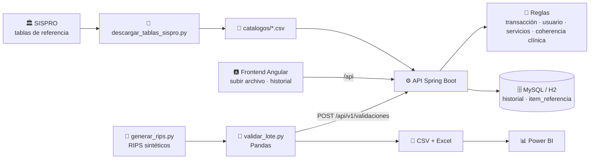

<div align="center">

# 🩺 RIPS Validator

**Valida los RIPS en JSON (Resolución 2275 de 2023) antes de enviarlos al Ministerio de Salud**
y explica cada error con la ruta exacta del campo.


</div>

## ¿Qué problema resuelve?

Desde la Resolución 2275 de 2023, cada factura electrónica de salud viaja con sus RIPS en JSON y
el Ministerio la valida antes de entregar el CUV. Cuando algo falla, el prestador se entera tarde y
con mensajes poco claros. Este proyecto revisa el archivo **antes** de enviarlo:

- 📍 Señala el campo exacto: `usuarios[0].servicios.consultas[2].codDiagnosticoPrincipal`.
- 📚 Busca cada código en las **tablas de referencia oficiales de SISPRO**: CIE-10, CUPS, municipios, países y 12 tablas más.
- 🧠 Cruza datos: diagnóstico contra sexo y edad (según la CIE-10), CUPS de consulta frente a procedimiento, documento contra edad, atención contra nacimiento, copago contra valor del servicio.
- 📊 Guarda el historial y exporta los hallazgos para analizarlos en Power BI.

> ⚠️ Proyecto de portafolio, **no oficial**. No reemplaza la validación del Ministerio. Todos los
> datos de ejemplo son sintéticos: ninguno corresponde a pacientes reales.

## ¿Qué RIPS valida?

| | |
|---|---|
| **Formato** | RIPS en **JSON** de la Resolución 2275 de 2023: el que acompaña a la factura electrónica de venta en salud (FEV) y con el que el Ministerio genera el CUV |
| **Transacción** | Obligado, número de factura y tipo de nota (incluida `RS`, RIPS sin factura) |
| **Usuarios** | Identificación, tipo de usuario, sexo, residencia, fecha de nacimiento y consecutivos |
| **Servicios validados** | ✅ Consultas · ✅ Procedimientos · ✅ Urgencias · ✅ Hospitalización · ✅ Recién nacidos · ✅ Medicamentos · ✅ Otros servicios |
| **Prestador** | Código de habilitación contra el REPS (tabla `IPSCodHabilitacion` de SISPRO) |
| **Factura electrónica** | Opcional: con el XML de la DIAN (Invoice o AttachedDocument) se cruzan número, emisor, valor y fechas |
| **No aplica** | Los RIPS antiguos en archivos planos (Resolución 3374 de 2000: `AF`, `US`, `AC`, `AP`…) |

## Tablas de referencia de SISPRO

El validador no inventa catálogos: usa las tablas que publica el Ministerio en la
[consulta pública de SISPRO](https://web.sispro.gov.co/WebPublico/Consultas/ConsultarReferenciaBasica.aspx).

| Tabla | Códigos | Para qué campo |
|---|---:|---|
| `CIE10` | 12.634 | Diagnósticos; además, sexo y rango de edad en que aplica cada uno |
| `CUPSRips` | 13.640 | `codConsulta` y `codProcedimiento`; si se reporta como consulta (AC) o procedimiento (AP) |
| `Municipio` · `Pais` | 1.124 · 249 | Residencia y país de origen |
| `TipoIdPISIS` · `Sexo` · `RIPSTipoUsuarioVersion2` · `ZonaVersion2` | | Datos del usuario |
| `ModalidadAtencion` · `GrupoServicios` · `RIPSFinalidadConsultaVersion2` · `RIPSCausaExternaVersion2` · `ViaIngresoUsuario` · `RIPSTipoDiagnosticoPrincipalVersion2` · `conceptoRecaudo` · `TipoNota` | | Datos de los servicios y la transacción |

[`etl/descargar_tablas_sispro.py`](etl/descargar_tablas_sispro.py) las descarga de la consulta
pública y las deja en [`catalogos/`](catalogos), junto con la fecha de descarga. La API las
empaqueta en el jar, las carga en memoria para validar y, al arrancar, las copia en la tabla
`item_referencia` de la base de datos para cruzarlas en SQL o Power BI. Para actualizarlas:

```bash
cd etl && python descargar_tablas_sispro.py --salida ../catalogos
```

También están el REPS (`IPSCodHabilitacion`, 207.495 sedes, e `IPSnoREPS`), condición de egreso, tipo de
medicamento y de otro servicio, unidades de medida (`UMM`) y formas farmacéuticas (`FFM`): 23 tablas y
238.695 códigos. Aún no se validan `codServicio` ni el CUM de los medicamentos. Los ejemplos y el
generador usan códigos REPS reales de hospitales públicos (E.S.E.) solo para que los datos sintéticos
pasen la regla RV007.

## Arquitectura



| Carpeta | Contenido |
|---|---|
| [`api/`](api) | API REST en Spring Boot 4 (Java 21) con las reglas, el historial y Swagger |
| [`web/`](web) | Frontend en Angular 22 con Tailwind CSS 4 e íconos de Lucide: arrastrar el archivo, ver los hallazgos filtrables y consultar el historial |
| [`etl/`](etl) | Descarga de tablas de SISPRO, generador de RIPS sintéticos y validador por lotes con reporte en CSV y Excel |
| [`catalogos/`](catalogos) | Las 16 tablas de referencia de SISPRO en CSV y `metadatos.json` con la fecha de descarga |
| [`powerbi/`](powerbi) | Reporte de Power BI (PBIP) con 5 páginas y su generador |
| [`ejemplos/`](ejemplos) | Un RIPS válido y uno con errores, que también usan las pruebas (el frontend sirve una copia en `web/public/ejemplos`) |

## Inicio rápido

**Con Docker** (frontend + API + MySQL), y luego abre http://localhost:4200:

```bash
docker compose up --build
```

**Sin Docker** (base H2 en memoria), en dos terminales. En CMD de Windows se escribe `mvnw` sin `./`:

```bash
cd api && ./mvnw spring-boot:run
```

```bash
cd web && npm install && npm start
```

Abre http://localhost:4200 y sube los dos archivos, que son obligatorios: el RIPS (`.json`) y el XML de su factura electrónica; o usa uno de los ejemplos sintéticos. La API sigue aceptando el RIPS solo en `POST /api/v1/validaciones`, que es lo que usa el validador por lotes. En desarrollo, Angular
reenvía `/api` a la API en el puerto 8080 ([`proxy.conf.json`](web/proxy.conf.json)).

La documentación interactiva de la API está en http://localhost:8080/swagger-ui.html. También puedes validar desde la terminal:

```bash
curl -X POST http://localhost:8080/api/v1/validaciones -H "Content-Type: application/json" --data-binary @ejemplos/rips-con-errores.json
```

## API

| Método | Ruta | Descripción |
|---|---|---|
| `POST` | `/api/v1/validaciones` | Valida un RIPS y guarda el resultado (responde `201` aunque tenga errores) |
| `GET` | `/api/v1/validaciones?page=0&size=20` | Historial paginado, del más reciente al más antiguo |
| `GET` | `/api/v1/validaciones/{id}` | Resultado completo con sus hallazgos |
| `GET` | `/api/v1/reglas` | Catálogo de reglas |
| `GET` | `/api/v1/tablas` | Tablas de SISPRO cargadas, con su tamaño y fecha de descarga |
| `GET` | `/api/v1/tablas/{tabla}/{codigo}` | Busca un código, p. ej. `/api/v1/tablas/CIE10/O800` |
| `GET` | `/api/v1/exportaciones/{validaciones,hallazgos,reglas}.csv` | Historial en CSV, listo para Power BI o Excel |
| `GET` | `/api/v1/exportaciones/power-bi.zip` | Reporte de Power BI apuntando a esta API |

Respuesta real con [`ejemplos/rips-con-errores.json`](ejemplos/rips-con-errores.json) (recortada):

```json
{
  "id": 1,
  "numFactura": "FEV1002",
  "estado": "RECHAZADO",
  "totalUsuarios": 3,
  "totalServicios": 2,
  "totalErrores": 12,
  "totalAdvertencias": 2,
  "hallazgos": [
    {
      "codigo": "RV030",
      "severidad": "ERROR",
      "ruta": "usuarios[0].servicios.consultas[0].codDiagnosticoPrincipal",
      "mensaje": "Los diagnósticos del capítulo O (embarazo, parto y puerperio) no aplican a usuarios de sexo H",
      "valor": "O800"
    },
    {
      "codigo": "RV041",
      "severidad": "ERROR",
      "ruta": "usuarios[0].servicios.consultas[0].valorPagoModerador",
      "mensaje": "El pago moderador supera el valor del servicio (45000)",
      "valor": "52000"
    }
  ]
}
```

El estado es `VALIDO`, `VALIDO_CON_ADVERTENCIAS` o `RECHAZADO`. Por privacidad, el RIPS no se
guarda: solo el resumen y los hallazgos.

## Reglas

| Código | Severidad | Regla |
|---|---|---|
| RV001 | Error | Campo obligatorio sin diligenciar |
| RV002 | Error | Formato inválido (código REPS, número de documento, factura…) |
| RV003 | Error | Código que no existe en la tabla de referencia de SISPRO |
| RV004 | Error | Fecha inexistente, mal formada o posterior a hoy |
| RV005 | Error | Código deshabilitado en SISPRO |
| RV006 | Error | CUPS de consulta reportado como procedimiento, o al revés |
| RV007 | Error | Prestador que no está habilitado en el REPS |
| RV010 | Error | Transacción sin usuarios |
| RV011 | Error | Usuario repetido en la transacción |
| RV012 | Error | Consecutivo fuera de secuencia |
| RV013 | Advertencia | Usuario sin servicios reportados |
| RV020 | Advertencia | Tipo de documento que no corresponde a la edad (RC, TI, CC) |
| RV021 | Error | Atención anterior a la fecha de nacimiento |
| RV022 | Error | Egreso anterior al ingreso (urgencias, hospitalización, recién nacidos) |
| RV030 | Error | Diagnóstico que no aplica al sexo del usuario según la CIE-10 de SISPRO |
| RV031 | Advertencia | Diagnóstico relacionado igual al principal |
| RV032 | Advertencia | Diagnóstico fuera del rango de edad de la CIE-10 (edad el día de la atención) |
| RV040 | Error | Valor monetario negativo |
| RV041 | Error | Pago moderador mayor que el valor del servicio |
| RV042 | Advertencia | Servicio con valor cero |
| RV043 | Error | Cantidad o peso que debe ser mayor que cero |
| RV050 | Error | Número de factura distinto al del XML de la factura electrónica |
| RV051 | Error | Obligado distinto al emisor de la factura |
| RV052 | Advertencia | Suma de `vrServicio` distinta al valor bruto de la factura |
| RV053 | Advertencia | Atención posterior a la emisión de la factura |

Para agregar reglas basta con crear una clase que implemente
[`ReglaRips`](api/src/main/java/com/zseuz/rips/reglas/ReglaRips.java): Spring la registra sola.

## Explicación con IA (opcional)

Cada hallazgo puede mostrar **✨ Explicar y cómo corregirlo**: la IA responde qué significa, cómo
corregirlo y qué pasa si no se corrige, en JSON estructurado. Funciona con **Gemini** o con **Claude**:

| Variable de entorno | Proveedor | Modelo por defecto |
|---|---|---|
| `GEMINI_API_KEY` | Gemini (API REST `generateContent`) | `gemini-3.5-flash` (`rips.ia.gemini.modelo`) |
| `ANTHROPIC_API_KEY` | Claude (SDK oficial de Anthropic) | `claude-opus-5-5` (`rips.ia.claude.modelo`) |

Con `rips.ia.proveedor=auto` (por defecto) se usa Gemini si hay su clave y, si no, Claude; también se
puede fijar `gemini` o `claude`. No se envían datos personales (documentos ni fechas de nacimiento), las
explicaciones se guardan para no pagar dos veces la misma, cuentan dentro del límite por minuto y, si
Gemini está sobrecargado (500/503), se reintenta dos veces antes de avisar. Sin ninguna clave, todo lo
demás funciona igual y el botón no aparece.

## Base de datos

El esquema está versionado con Flyway en
[`db/migration`](api/src/main/resources/db/migration); Hibernate solo comprueba que coincida. En
desarrollo la base es H2 en archivo (`api/data/`), así que el historial sobrevive a los reinicios, y se
puede consultar en http://localhost:8080/h2-console (JDBC URL `jdbc:h2:file:./data/rips;AUTO_SERVER=TRUE`,
usuario `sa`). Con Docker es MySQL. Las validaciones están limitadas a 25 MB por archivo y 60 por minuto
por IP.

## Power BI

En el frontend, **Historial › Descargar reporte** entrega un `.zip` con el proyecto de Power BI
(PBIP) ya apuntando a la API. Se abre `RipsValidator.pbip` en Power BI Desktop y se pulsa
**Actualizar**: las tablas se leen de los CSV de la API con Power Query.

| Página | Qué muestra |
|---|---|
| Resumen | Validaciones, % de rechazo, % listas para enviar, errores, advertencias y tendencia diaria |
| Reglas | Hallazgos y facturas afectadas por regla, grupo y severidad |
| Códigos | Diagnósticos, CUPS, municipios y países con más hallazgos, con su nombre oficial de SISPRO |
| Detalle | Un renglón por hallazgo, para preparar la corrección de un archivo |
| Cómo usar | Origen de los datos y definición de los 18 indicadores DAX |

El modelo, las medidas y las páginas los genera [`powerbi/generar_pbip.py`](powerbi/generar_pbip.py).
Más detalle en [`powerbi/README.md`](powerbi/README.md).

## ETL: validación por lotes

```bash
cd etl
pip install -r requirements.txt
python generar_rips.py --facturas 50 --tasa-errores 0.3 --semilla 7 --salida datos
python validar_lote.py datos --api http://localhost:8080 --reporte reporte
```

`generar_rips.py` crea facturas sintéticas y daña una parte a propósito (embarazo en hombre, CUPS
incompleto, usuario duplicado…). `validar_lote.py` las envía a la API y deja en `reporte/` las
tablas `facturas.csv`, `hallazgos.csv` y `resumen.xlsx`, listas para Power BI.

Ejemplo con 60 facturas (`--semilla 11`), 17 de ellas con errores inyectados: contra las tablas de
SISPRO, el validador aceptó las 43 limpias sin ningún falso positivo y rechazó las 17 dañadas.

## Pruebas

```bash
cd api && ./mvnw verify
```

```bash
cd web && npx ng test --watch=false
```

```bash
cd web && npm run e2e
```

- **API:** 55 pruebas (las reglas una por una contra las tablas reales de SISPRO, la factura XML, las
  exportaciones, los límites y la API completa con MockMvc).
- **Frontend:** 8 pruebas unitarias con Vitest.
- **Punta a punta:** 6 pruebas con Playwright que manejan el frontend real contra la API real (subir
  archivos, filtros, factura XML, historial, tema). Necesitan el jar: `cd api && ./mvnw -DskipTests package`.

En cada push, el [CI](.github/workflows/ci.yml) corre todo eso y además valida un lote sintético contra la
API real. Cada mes, [otro workflow](.github/workflows/tablas-sispro.yml) vuelve a descargar las tablas de
SISPRO y abre un PR si cambió algún código.

## Hoja de ruta

- [x] Frontend en Angular: subir el archivo, ver los errores resaltados y consultar el historial
- [x] Explicación de cada error con IA (Gemini o Claude) en lenguaje sencillo
- [x] Reporte de Power BI descargable, conectado a la API
- [x] Urgencias, hospitalización, recién nacidos, medicamentos y otros servicios
- [x] Tablas de referencia oficiales de SISPRO (CIE-10, CUPS, municipios…) en la base de datos
- [x] Validar el prestador contra el REPS
- [x] Cruce de los RIPS con el XML de la factura electrónica
- [x] Base de datos persistente con Flyway, límites de uso y pruebas de punta a punta
- [ ] Validar el CUM de los medicamentos y `codServicio`

---

<div align="center">

Hecho por [Jonathan Ramírez](https://github.com/zseuz) · [Portafolio](https://zseuz.github.io/) · [LinkedIn](https://www.linkedin.com/in/jonathan-pava-ramirez/)

</div>
