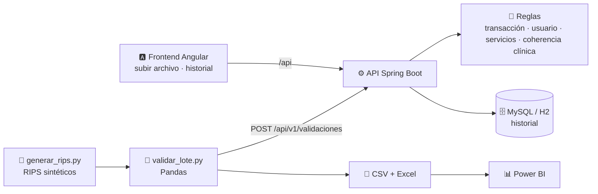

<div align="center">

# 🩺 RIPS Validator

**Valida los RIPS en JSON (Resolución 2275 de 2023) antes de enviarlos al Ministerio de Salud**
y explica cada error con la ruta exacta del campo.


</div>

## ¿Qué problema resuelve?

Desde la Resolución 2275 de 2023, cada factura electrónica de salud viaja con sus RIPS en JSON y
el Ministerio la valida antes de entregar el CUV. Cuando algo falla, el prestador se entera tarde y
con mensajes poco claros. Este proyecto revisa el archivo **antes** de enviarlo:

- 📍 Señala el campo exacto: `usuarios[0].servicios.consultas[2].codDiagnosticoPrincipal`.
- 🧠 Además del formato, cruza datos: diagnóstico contra sexo, documento contra edad, fecha de atención contra nacimiento, copago contra valor del servicio.
- 📊 Guarda el historial y exporta los hallazgos para analizarlos en Power BI.

> ⚠️ Proyecto de portafolio, **no oficial**. No reemplaza la validación del Ministerio. Los
> catálogos son un subconjunto de las tablas de SISPRO, y todos los datos de ejemplo son
> sintéticos: ninguno corresponde a pacientes reales.

## ¿Qué RIPS valida?

| | |
|---|---|
| **Formato** | RIPS en **JSON** de la Resolución 2275 de 2023: el que acompaña a la factura electrónica de venta en salud (FEV) y con el que el Ministerio genera el CUV |
| **Transacción** | Obligado, número de factura y tipo de nota (incluida `RS`, RIPS sin factura) |
| **Usuarios** | Identificación, tipo de usuario, sexo, residencia, fecha de nacimiento y consecutivos |
| **Servicios validados** | ✅ Consultas · ✅ Procedimientos |
| **Aún no** | Urgencias, hospitalización, recién nacidos, medicamentos y otros servicios: se aceptan, pero no se revisan |
| **No aplica** | Los RIPS antiguos en archivos planos (Resolución 3374 de 2000: `AF`, `US`, `AC`, `AP`…) |

## Arquitectura



| Carpeta | Contenido |
|---|---|
| [`api/`](api) | API REST en Spring Boot 4 (Java 21) con las reglas, el historial y Swagger |
| [`web/`](web) | Frontend en Angular 22: arrastrar el archivo, ver los hallazgos filtrables y consultar el historial |
| [`etl/`](etl) | Generador de RIPS sintéticos y validador por lotes con reporte en CSV y Excel |
| [`ejemplos/`](ejemplos) | Un RIPS válido y uno con errores, que también usan las pruebas (el frontend sirve una copia en `web/public/ejemplos`) |

## Inicio rápido

**Con Docker** (frontend + API + MySQL), y luego abre http://localhost:4200:

```bash
docker compose up --build
```

**Sin Docker** (base H2 en memoria), en dos terminales. En CMD de Windows se escribe `mvnw` sin `./`:

```bash
cd api && ./mvnw spring-boot:run
```

```bash
cd web && npm install && npm start
```

Abre http://localhost:4200, arrastra un `.json` o usa los botones de ejemplo. En desarrollo, Angular
reenvía `/api` a la API en el puerto 8080 ([`proxy.conf.json`](web/proxy.conf.json)).

La documentación interactiva de la API está en http://localhost:8080/swagger-ui.html. También puedes validar desde la terminal:

```bash
curl -X POST http://localhost:8080/api/v1/validaciones -H "Content-Type: application/json" --data-binary @ejemplos/rips-con-errores.json
```

## API

| Método | Ruta | Descripción |
|---|---|---|
| `POST` | `/api/v1/validaciones` | Valida un RIPS y guarda el resultado (responde `201` aunque tenga errores) |
| `GET` | `/api/v1/validaciones?page=0&size=20` | Historial paginado, del más reciente al más antiguo |
| `GET` | `/api/v1/validaciones/{id}` | Resultado completo con sus hallazgos |
| `GET` | `/api/v1/reglas` | Catálogo de reglas |

Respuesta real con [`ejemplos/rips-con-errores.json`](ejemplos/rips-con-errores.json) (recortada):

```json
{
  "id": 1,
  "numFactura": "FEV1002",
  "estado": "RECHAZADO",
  "totalUsuarios": 3,
  "totalServicios": 2,
  "totalErrores": 12,
  "totalAdvertencias": 2,
  "hallazgos": [
    {
      "codigo": "RV030",
      "severidad": "ERROR",
      "ruta": "usuarios[0].servicios.consultas[0].codDiagnosticoPrincipal",
      "mensaje": "Los diagnósticos del capítulo O (embarazo, parto y puerperio) no aplican a usuarios de sexo H",
      "valor": "O800"
    },
    {
      "codigo": "RV041",
      "severidad": "ERROR",
      "ruta": "usuarios[0].servicios.consultas[0].valorPagoModerador",
      "mensaje": "El pago moderador supera el valor del servicio (45000)",
      "valor": "52000"
    }
  ]
}
```

El estado es `VALIDO`, `VALIDO_CON_ADVERTENCIAS` o `RECHAZADO`. Por privacidad, el RIPS no se
guarda: solo el resumen y los hallazgos.

## Reglas

| Código | Severidad | Regla |
|---|---|---|
| RV001 | Error | Campo obligatorio sin diligenciar |
| RV002 | Error | Formato inválido (CUPS, CIE-10, código REPS, DIVIPOLA…) |
| RV003 | Error | Valor que no existe en el catálogo |
| RV004 | Error | Fecha inexistente, mal formada o posterior a hoy |
| RV010 | Error | Transacción sin usuarios |
| RV011 | Error | Usuario repetido en la transacción |
| RV012 | Error | Consecutivo fuera de secuencia |
| RV013 | Advertencia | Usuario sin servicios reportados |
| RV020 | Advertencia | Tipo de documento que no corresponde a la edad (RC, TI, CC) |
| RV021 | Error | Atención anterior a la fecha de nacimiento |
| RV030 | Error | Diagnóstico incompatible con el sexo (capítulo O en hombres, próstata en mujeres) |
| RV031 | Advertencia | Diagnóstico relacionado igual al principal |
| RV040 | Error | Valor monetario negativo |
| RV041 | Error | Pago moderador mayor que el valor del servicio |
| RV042 | Advertencia | Servicio con valor cero |

Para agregar reglas basta con crear una clase que implemente
[`ReglaRips`](api/src/main/java/com/zseuz/rips/reglas/ReglaRips.java): Spring la registra sola.

## ETL: validación por lotes

```bash
cd etl
pip install -r requirements.txt
python generar_rips.py --facturas 50 --tasa-errores 0.3 --semilla 7 --salida datos
python validar_lote.py datos --api http://localhost:8080 --reporte reporte
```

`generar_rips.py` crea facturas sintéticas y daña una parte a propósito (embarazo en hombre, CUPS
incompleto, usuario duplicado…). `validar_lote.py` las envía a la API y deja en `reporte/` las
tablas `facturas.csv`, `hallazgos.csv` y `resumen.xlsx`, listas para Power BI.

Ejemplo con 40 facturas, 13 de ellas con errores inyectados: el validador marcó como válidas las
27 limpias, rechazó 12 y dejó una con advertencias (la que solo tenía el documento que no
correspondía a la edad).

## Pruebas

```bash
cd api && ./mvnw verify
```

```bash
cd web && npx ng test --watch=false
```

La API tiene 25 pruebas (las reglas una por una y la API completa con MockMvc) y el frontend 6
(con Vitest). En cada push, el [CI](.github/workflows/ci.yml) además genera un lote sintético, lo
valida contra la API real y publica el reporte como artefacto.

## Hoja de ruta

- [x] Frontend en Angular: subir el archivo, ver los errores resaltados y consultar el historial
- [ ] Explicación de cada error con IA (Claude) en lenguaje sencillo
- [ ] Tablero de Power BI sobre `hallazgos.csv`
- [ ] Urgencias, hospitalización, recién nacidos, medicamentos y otros servicios
- [ ] Catálogos completos de SISPRO cargados desde archivo
- [ ] Cruce de los totales de los RIPS con el XML de la factura electrónica

---

<div align="center">

Hecho por [Jonathan Ramírez](https://github.com/zseuz) · [Portafolio](https://zseuz.github.io/) · [LinkedIn](https://www.linkedin.com/in/jonathan-pava-ramirez/)

</div>
